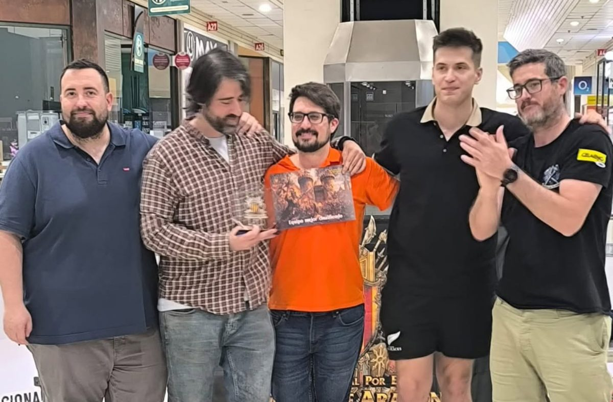
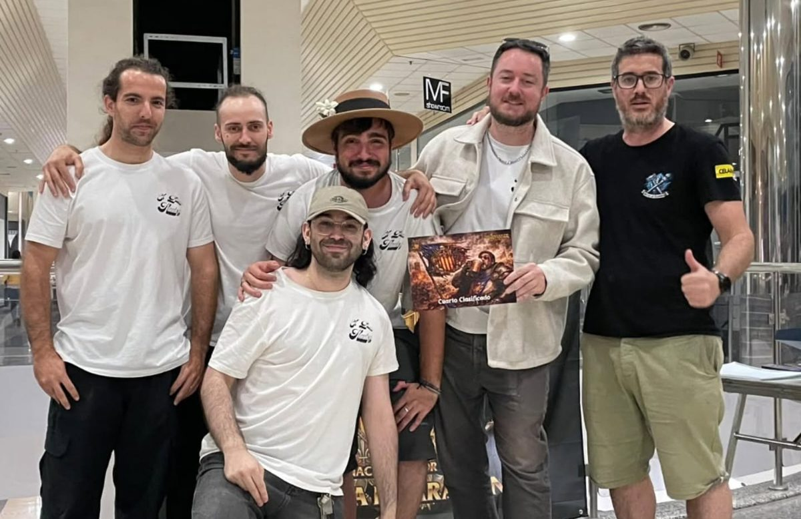

Hace dos años, elegir a la selección española de **Warhammer: The Old World** se resolvió en un fin de semana. Hoy hay un censo de capitanes que vota las normas, unas bases de 39 páginas y un calendario con **nueve clasificatorios** que empieza en Zaragoza el 19 de diciembre y termina con la **Final Nacional en Alcalá de la Selva (Teruel)** los días 15 y 16 de mayo de 2027.

El competitivo español ha cambiado mucho y muy deprisa, y no siempre sin ruido.

## 2025: solo una final

El primer intento fue el más sencillo: una única **final abierta en Talavera** a la que podía apuntarse cualquier equipo y que reunió a **alrededor de medio centenar de jugadores**. Funcionó como punto de partida, pero dejó una duda que ha marcado todo lo que vino después: ¿basta un único torneo para elegir al mejor equipo posible, o se presta demasiado al azar y se desvirtúa con la presencia de equipos sin un mínimo nivel competitivo?

## 2026: tres regionales, una final y un cuarto puesto mundial

Para 2026 se optó por **clasificatorios regionales con equipos de cuatro** y una final con equipos de ocho, el formato del Mundial. Se celebraron tres:

| Clasificatorio | Equipos | Plazas para la final |
|---|---|---|
| Torrent (Corona de Aragón) | 20 | 7 |
| Leganés (Madrid) | 12 | 4 |
| El Ejido (Andalucía) | 8 | 3 |

Los de **León** y **Canarias** no salieron adelante y el **País Vasco** no participó. Aun así, el censo de la temporada recoge **181 jugadores distintos**, casi la mitad de ellos en la Comunidad Valenciana.

*Club de Caballeros, ganador del clasificatorio de Torrent y base de la selección española que terminó cuarta en el Mundial. Foto: [Circuito TOW Corona de Aragón](https://www.instagram.com/p/DXG-EJQDDwR/).*

La final se jugó el 20 y 21 de junio en [El Arca Negra](https://elarcanegra.com/) (Leganés) con **catorce equipos de ocho**. Tanto el clasificatorio de Madrid como la final, ambos en la misma sede, se recuerdan como torneos **bien organizados y cuidados**, de los que los participantes salieron muy contentos. Contaron además con el apoyo de marcas como **ImpriWars**, presente como patrocinadora en buena parte de los torneos por equipos del país. Ya lo contamos en [nuestra crónica del camino al Mundial](/torneos/2026/04/29/clasificatorios-seleccion-espanola-tow-wtc-2026.html).

El sistema también enseñó sus costuras. El regional de la **Corona de Aragón** multiplicaba por dos y medio al de Andalucía y nadie se planteó dividirlo para tener clasificatorios más parejos, a pesar de que abarcaba cuatro comunidades autónomas. Además, para completar los equipos de ocho de la final, **una veintena de jugadores** se incorporaron sin haber jugado ningún regional, y el debate sobre esos «mercenarios» ha estado muy presente al preparar 2027.

*El Gran Flautón, uno de los siete equipos que salieron de Torrent hacia la final de Leganés. Foto: [Circuito TOW Corona de Aragón](https://www.instagram.com/p/DXG-EJQDDwR/).*

### Talavera: un Mundial del que se esperaba más

En septiembre, Talavera, de la mano de [Invasión Talavera](https://invasiontalavera.es/), acogió el [WTC Clash of Nations 2026](https://worldteamchampionship.com/), con 20 selecciones. España terminó **cuarta**, a solo dos puntos del bronce, y en el individual llegó el **doblete español**: Jrost campeón del mundo y Lafuente subcampeón. Lo contamos con detalle en [nuestra crónica del Mundial](/torneos/2026/10/03/mundial-the-old-world-talavera-2026.html), y en el Heraldo puedes ver también la entrevista [«¿Cómo se llega a ser el mejor jugador de Warhammer: The Old World? | La Taberna del Trol #7»](/videos/2026-07-30-yt-UICgh3iTPOk.html).

En lo deportivo, un éxito. En lo organizativo, la sensación general fue algo decepcionante. Para ser un campeonato del mundo, el evento resultó pobre: solo un par de expositores de marcas poco relacionadas con el juego, y el del propio organizador, pequeño y no muy surtido. Nada que ver con lo que los habituales están acostumbrados a ver en Talavera. Las instalaciones se limitaron a un espacio amplio con tableros sobre borriquetas y un único puesto de comida, también pequeño. Muy lejos de lo que se espera de un Mundial, y muy por debajo de lo visto el año anterior en Austria. Más aún tratándose de la escena española y, en especial, de Talavera, donde se montan GT espectaculares: el de Warhammer 40.000 se presenta como el mayor torneo por equipos del mundo, con más de cien equipos. El individual, además, se jugó **miércoles y jueves** y se quedó en apenas 36 jugadores. La sensación que flotaba en el ambiente era que los clasificatorios, y en especial el de Torrent, habían tenido más categoría que el propio Mundial.

## 2027: nueve clasificatorios y una final de 16

Con el cuarto puesto como aval, la organización del circuito abrió en octubre un proceso de votaciones entre un **censo de 54 capitanes** de equipo. Las grandes decisiones salieron por mayorías muy amplias:

- **Sistema de clasificatorios** frente a una única final abierta: **52 votos contra 2**.
- **Clasificatorios abiertos**: cualquier equipo puede jugar cualquiera de ellos (51 contra 3).
- **Equipos de 6** en los clasificatorios y **de 8 en la final** (35 de 53 votos). El objetivo declarado es dar el salto a equipos de 8 en 2028.
- **Final de 16 equipos**, dos más que en 2026 (46 contra 1), aunque la única alternativa sobre la mesa era mantener los 14.
- **Todo se juega con el reglamento del WTC**, con las listas enviadas 14 días antes y las reglas y FAQ congeladas 21 días antes de cada torneo.

Este es el calendario provisional:

| Sede | Fechas |
|---|---|
| Zaragoza | 19-20 de diciembre de 2026 |
| Barcelona | 30-31 de enero de 2027 |
| Madrid (Leganés) | 20-21 de febrero |
| Campos (Mallorca) | 27-28 de febrero |
| Santiago de Compostela | 13-14 de marzo |
| El Ejido (Almería) | 27-28 de marzo |
| Tenerife | 3-4 de abril |
| Ciudad Real | 3-4 de abril |
| Valencia | 17-18 de abril |
| **Final Nacional: Alcalá de la Selva (Teruel)** | **15-16 de mayo** |

Algunas fechas, como la de Tenerife, todavía no están confirmadas por sus organizadores.

### Cómo se clasifica

- Un torneo solo cuenta como clasificatorio si reúne al menos **6 equipos completos de 6**. Con 6 u 8 equipos se juegan 4 rondas; con 10 o más, 5.
- Las 16 plazas de la final son para los **9 campeones** y **7 segundos**. Se queda fuera el segundo del clasificatorio con menos participación, y las plazas de segundos se anuncian tras el último torneo, en Valencia.
- Un equipo ya clasificado puede seguir jugando otros clasificatorios, pero no opta a otra plaza.
- **Canarias** tiene una excepción por su dispersión entre islas: puede elegir un torneo de 4 o 6 equipos, o uno individual de al menos 24 jugadores cuyos 8 primeros forman el equipo canario de la final. La comunidad canaria ronda los 50 jugadores, pero hasta ahora ha respondido mucho mejor al formato individual que al de equipos.

La norma más debatida es la de los **refuerzos**. Cada equipo dispone de **dos comodines** para sumar a un jugador ya clasificado con otro equipo, y cada jugador clasificado solo puede hacer de refuerzo dos veces. En la final, cada equipo debe conservar al menos **4 de los 6** jugadores que ganaron la plaza. La idea es que una baja de última hora no deje a un equipo sin torneo; el riesgo, que algún equipo se «arrastre» a la final gracias a dos jugadores de nivel. Se ha optado por probarlo y revisarlo con datos al final de temporada.

Las bases incluyen además un guiño a la actualidad del juego: los clasificatorios usarán en pruebas la **canalización** y la nueva **tabla de disfunción** del Arcane Journal *The March of Chaos*, porque el WTC estudia incorporarlas. Si el WTC las descarta, desaparecerán para la final.

## Lo que dicen los datos: más estructura, la misma base

Que haya más torneos no significa necesariamente que haya más jugadores. Para comprobarlo hemos consultado las dos plataformas que más usa el circuito internacional, **Best Coast Pairings** y **New Recruit**.

En **BCP**, la oferta de eventos de The Old World crece: **98 eventos listados en octubre de 2026**, frente a 80 en octubre de 2025, y 80 y 86 en agosto y septiembre. Son fichas publicadas, no torneos verificados uno a uno, e incluyen ligas, dobles y alguna convocatoria sin inscritos, pero la tendencia es clara.

En **New Recruit**, que registra partidas y jugadores de torneo, el panorama es más estable:

| Mes | Partidas | Jugadores |
|---|---|---|
| Octubre 2025 | 1.150 | 645 |
| Octubre 2026 | 1.196 | 641 |

Prácticamente los mismos jugadores que hace un año. A lo largo de 2026 se ve además un ciclo muy marcado: el pico de jugadores llegó en **marzo (820)**, el de partidas en **septiembre (1.524)**, y **julio y agosto** fueron el valle, con menos de la mitad de actividad.

La lectura es que The Old World **no está en declive, pero tampoco vive un boom**. El circuito se sostiene con ligas y torneos locales, pequeños y medianos, además de las grandes citas, aunque con desigualdad: unos eventos se llenan y otros se quedan cortos. Ninguna de las dos plataformas mide ventas ni jugadores casuales, y pueden solaparse entre sí, así que conviene tomar estas cifras como una tendencia y no como un censo.

España encaja en ese patrón. El salto de 2026 a 2027 es sobre todo **territorial y organizativo**: de tres sedes a nueve, con Galicia, Baleares, Canarias y Castilla-La Mancha por primera vez en el mapa. Que la base de jugadores crezca al mismo ritmo está por ver.

## Los retos

### El norte se queda fuera, otra vez

No hay clasificatorio en el País Vasco, Navarra, Cantabria, Asturias ni Castilla y León. Parte del norte defendía una final única y abierta, con el argumento de que eventos masivos y sin filtros atraen a más gente al juego. La organización llegó a ofrecer una fórmula intermedia: mantener los clasificatorios para elegir a la selección y jugar a la vez una segunda final abierta a cualquier equipo. Esa propuesta nunca obtuvo respuesta, y desde el norte se dejó claro que, sin final abierta, no habría participación. Cuando una de las partes solo acepta su propio modelo, es difícil llegar a un acuerdo, y en la votación esa postura perdió de forma contundente. Que esos jugadores acaben sumándose al circuito o sigan por su cuenta será una de las claves de la temporada.

### Formar equipos de 6 cuesta

En la Comunidad Valenciana, Cataluña o Aragón hay masa de sobra; en otras zonas, juntar seis jugadores comprometidos para varios fines de semana al año es un reto. Por eso han surgido circuitos de entrada con equipos más pequeños y torneos de un día, como la **Copa Catalana** de equipos de cuatro, o los torneos paralelos que prepara Andalucía, pensados para que más gente se anime al juego por equipos sin la presión de clasificar.

### Un consenso con heridas

Las votaciones salieron por mayorías aplastantes, pero el camino hasta ellas fue cualquier cosa menos tranquilo. Durante meses, los grupos del circuito discutieron no solo el formato, sino quién tenía derecho a decidirlo: si solo los capitanes que habían jugado la temporada o toda la comunidad. Todo ello puso a los organizadores en una situación límite en muchas ocasiones, y tuvieron que soportar ataques y más de una descalificación injusta.

También es cierto que, según parece, a la organización le faltó en ocasiones mano izquierda para gestionar las situaciones de una forma más abierta y dialogante. El censo se cerró a quienes ya habían participado, los documentos tardaron meses en llegar y algunas decisiones, como la sede de la final, se tomaron sin votación. En otras ocasiones hubo quejas de que las decisiones venían predeterminadas y solo se dejaba elegir entre un abanico tan estrecho que poco importaba la elección, lo que explica la polémica a pesar de unas mayorías tan abultadas. Todo eso alimentó la sensación, en parte de la comunidad, de un proceso cerrado.

Pero las críticas también cruzaron líneas: hubo acusaciones de «chiringuito», de querer controlar el circuito para unos pocos y hasta de lucrarse con un trabajo que es voluntario. Alguno de los impulsores del circuito acabó dejando la organización, y se han anunciado expulsiones para quien falte al respeto. El modelo de 2027 tiene una mayoría clara y unas bases trabajadas. Lo que está por ver es si convence también a quienes perdieron.

### Las reglas, repartidas

El circuito español ha resuelto el problema por la vía práctica: si se clasifica para el WTC, se juega con las reglas del WTC. Pero en el resto del mundo conviven varios paquetes de composición y FAQ (WTC, ComFAQ, Renegade…) y, como señalaba [Bell of Lost Souls](https://www.belloflostsouls.net/2026/03/warhammer-the-old-world-games-workshop-is-losing-the-comp-wars.html), un mismo ejército puede funcionar distinto de un torneo a otro.

### Games Workshop, ausente

GW no organiza eventos oficiales de The Old World. Su [Mundial oficial de Warhammer](https://www.warhammer-community.com/en-gb/events/atqpv7zt/world-championships-of-warhammer-2026/), del 3 al 6 de diciembre en Barcelona, no incluye este juego. El competitivo de The Old World es, hoy por hoy, cosa de la comunidad.

## Conclusión

En tres temporadas, España ha pasado de improvisar una final a tener uno de los circuitos nacionales más estructurados de The Old World, y lo ha hecho con resultados: un cuarto puesto por equipos y un título mundial individual. Esa madurez no ha llegado gratis: un proceso tenso, una parte de la comunidad que no se siente representada y un norte que vuelve a quedarse fuera. El reto de 2027 ya no es organizarse, sino **crecer**: llenar nueve clasificatorios con equipos de seis, recuperar a quienes se han quedado al margen y llegar a 2028 con la base suficiente para competir con equipos de ocho.

El primer examen, el 19 y 20 de diciembre en Zaragoza. En el Heraldo seguiremos el circuito sede a sede.
